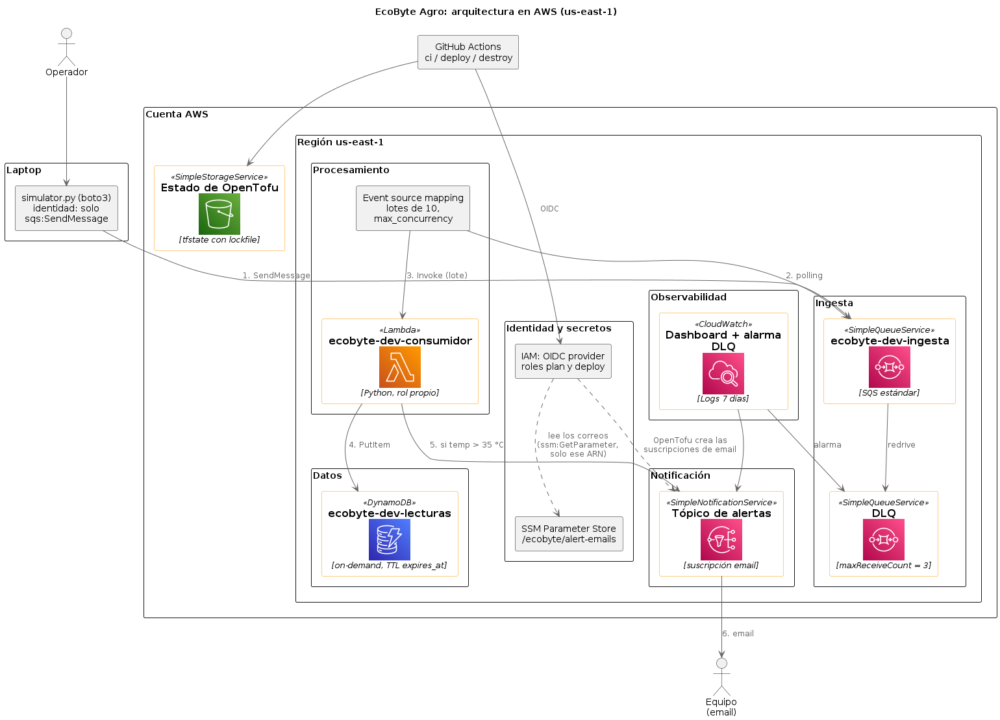
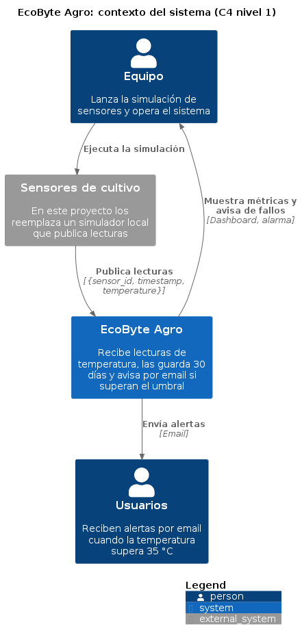
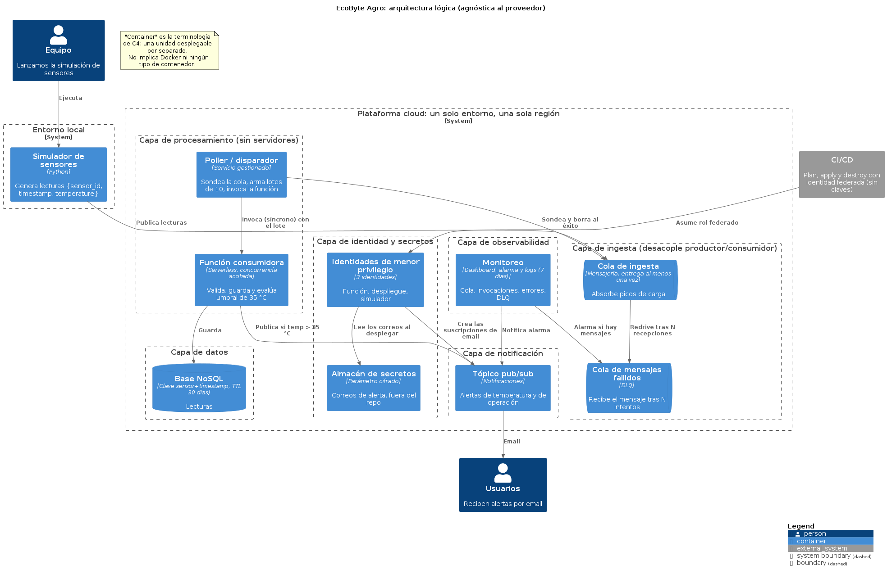
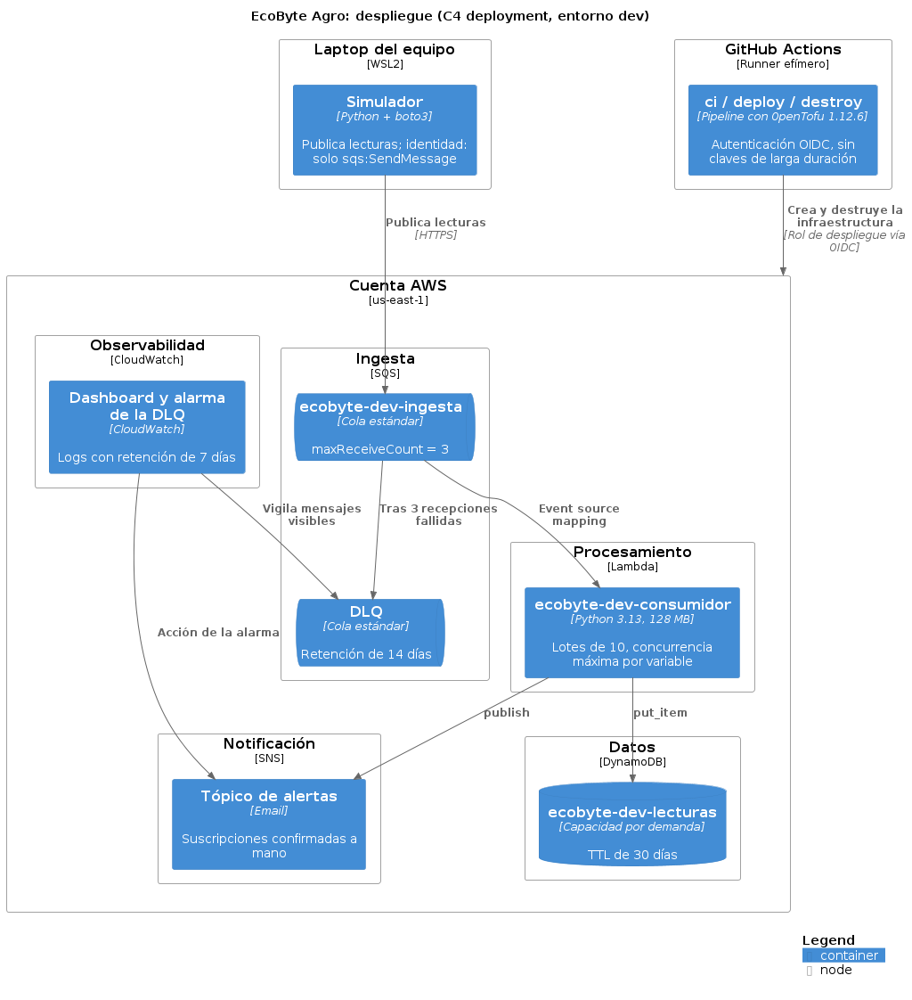
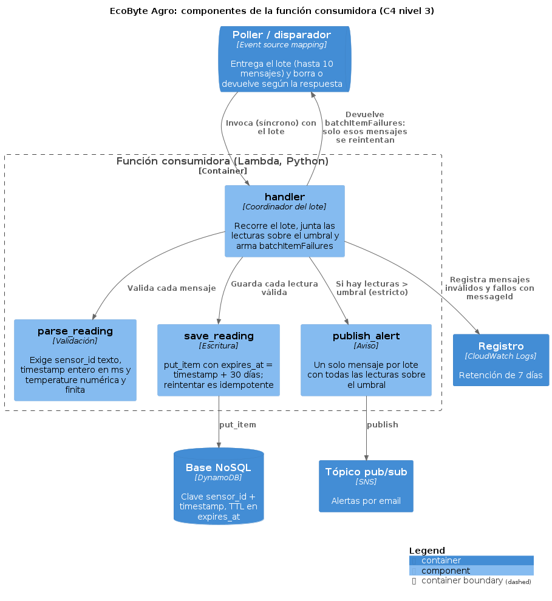
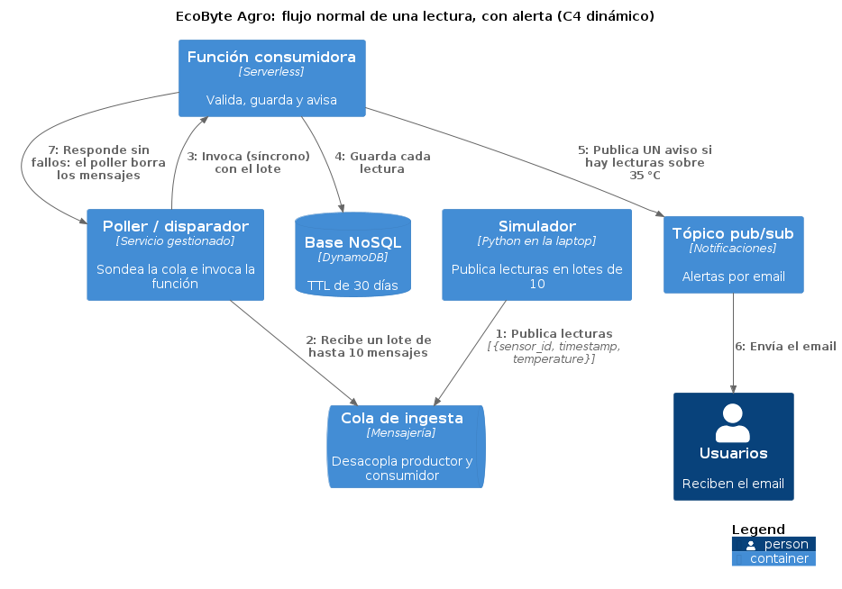
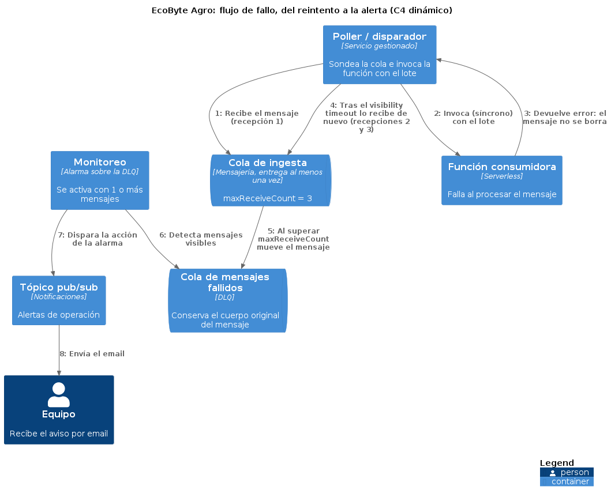
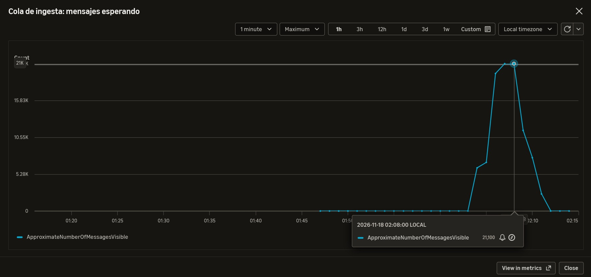

# EcoByte Agro

Telemetría de sensores de cultivo en AWS. Proyecto integrador de Cloud Computing (UCU), proyecto 5.

Un simulador publica lecturas de temperatura en una cola. Una función las procesa, las guarda 30 días y avisa por email si alguna supera 35 °C. El foco es la infraestructura: el código de la aplicación es mínimo a propósito, y todo lo demás está definido con OpenTofu y se despliega por un pipeline.



## Cómo funciona

```
simulador (laptop) -> SQS ingesta -> Lambda (lotes de 10) -> DynamoDB (TTL 30 días)
                          |                  |
                     (falla 3 veces)    temp > 35 °C -> SNS -> email
                          v
                         DLQ -> alarma de CloudWatch -> SNS -> email
```

1. El simulador envía lecturas `{"sensor_id", "timestamp", "temperature"}` a la cola de ingesta.
2. La cola desacopla a los sensores del procesamiento: si llegan más lecturas de las que se procesan, esperan en la cola sin perderse.
3. Lambda toma lotes de hasta 10 mensajes, con una concurrencia máxima configurable (5 en `dev`).
4. La función valida cada lectura y la guarda en DynamoDB con `expires_at` a 30 días, para que el TTL la borre sola.
5. Si alguna lectura del lote pasa de 35 °C, publica un solo email con todas ellas.
6. Los mensajes inválidos o que fallan vuelven a la cola (`batchItemFailures`). Después de 3 intentos pasan a la DLQ, y una alarma avisa por email.

| Componente | Servicio | Recurso |
|---|---|---|
| Cola de ingesta y DLQ | SQS | `ecobyte-dev-ingesta`, `ecobyte-dev-ingesta-dlq` |
| Función consumidora | Lambda (Python 3.13, 128 MB) | `ecobyte-dev-consumidor` |
| Base de lecturas | DynamoDB on-demand | `ecobyte-dev-lecturas` |
| Alertas | SNS (email) | `ecobyte-dev-alertas` |
| Observabilidad | CloudWatch | `ecobyte-dev-dashboard`, alarma de la DLQ, logs de 7 días |
| Secretos | SSM Parameter Store | `/ecobyte/alert-emails`, `/ecobyte/budget-emails` |
| Estado de OpenTofu | S3 con bloqueo | `ecobyte-agro-tfstate-<cuenta>` |

## Diagramas

Los diagramas están en [`docs/diagramas/`](docs/diagramas/), con su fuente en PlantUML (`.puml`) al lado de cada imagen.

### Contexto (C4 nivel 1)

Quién usa el sistema y qué intercambia con él: el equipo lanza la simulación, los sensores publican lecturas, los usuarios reciben las alertas y el equipo ve métricas y avisos de fallos.



### Arquitectura lógica (independiente del proveedor)

El mismo diseño con componentes genéricos: cola, función, base NoSQL, tópico, monitoreo, secretos e identidades. Se puede implementar en AWS, Google Cloud o Azure; ver las equivalencias en [`docs/provider-aws.md`](docs/provider-aws.md).



### Despliegue (C4 deployment)

Dónde corre cada parte: el simulador en la laptop, el pipeline en GitHub Actions y el resto en la cuenta de AWS (`us-east-1`), con los nombres reales de los recursos.



### Componentes de la función (C4 nivel 3)

Cómo está armado `handler.py`: `parse_reading` valida, `save_reading` guarda con TTL, `publish_alert` manda un aviso por lote y `handler` coordina y arma la lista de fallidos.



### Flujo normal de una lectura (C4 dinámico)

Del simulador a la cola, de la cola a la función, y de ahí a la tabla y, si pasa de 35 °C, al email.



### Flujo de fallo (C4 dinámico)

Un mensaje que falla se reintenta. A la tercera recepción pasa a la DLQ, la alarma lo detecta y avisa por email.



## Prueba de carga

Con cuatro simuladores en paralelo (40.000 lecturas a unos 222 por segundo), la cola llegó a 21.100 mensajes y se vació unos 5 minutos después de terminar el envío, sin errores ni mensajes en la DLQ. El consumidor procesó unos 84 mensajes por segundo con `max_concurrency = 5`. Los detalles y la proyección a 10x y 100x están en [`docs/escalabilidad.md`](docs/escalabilidad.md).



## Estructura del repo

```
app/lambda/          función consumidora (handler.py)
app/simulator/       simulador de sensores (ver su README)
infra/bootstrap/     presupuesto y OIDC de GitHub; se aplica una vez desde la laptop
infra/modules/       messaging, database, consumer, monitoring
infra/envs/dev/      conecta los módulos; lo aplica el pipeline
.github/workflows/   ci.yml, deploy.yml, destroy.yml
docs/                elección de provider, FinOps, escalabilidad y diagramas
```

## Requisitos

- Cuenta de AWS con un usuario IAM con MFA (nunca la cuenta root).
- [OpenTofu](https://opentofu.org) 1.12.6, AWS CLI 2.36.25 o más nuevo, Python 3 y `gh`.
- Para revisar antes de un PR: tflint 0.65.0 y Trivy 0.76.1.

Credenciales: localmente se usa `aws login` y en el pipeline, OIDC. No se crean access keys de larga duración.

## Despliegue

### 1. Una sola vez: bases de la cuenta

Se crean a mano, porque OpenTofu los necesita antes de poder correr:

- El bucket del estado, `ecobyte-agro-tfstate-<cuenta>`, con versionado, cifrado AES256 y sin acceso público.
- Los parámetros `SecureString` `/ecobyte/budget-emails` y `/ecobyte/alert-emails`, cada uno con una lista JSON de correos. Así los correos no quedan en el repo.

Después se aplica el bootstrap desde la laptop. Crea el presupuesto de USD 5 por mes, el proveedor OIDC de GitHub y los roles `ecobyte-github-plan` (solo lectura, para PRs) y `ecobyte-github-deploy`:

```bash
aws login
cd infra/bootstrap
tofu init
tofu plan
tofu apply
```

En GitHub hacen falta:

- Las variables de Actions `AWS_PLAN_ROLE_ARN` y `AWS_DEPLOY_ROLE_ARN`, con los ARN de los dos roles.
- Un environment `dev` con aprobación manual y despliegue solo desde `master`.

### 2. Cada cambio: pull request

Todo cambio entra por un PR a `master`, que está protegida. El workflow `ci` corre `tofu fmt`, `validate`, `tflint` y Trivy, y publica el `tofu plan` como comentario en el PR.

Para revisar lo mismo localmente antes de abrir el PR:

```bash
tofu fmt -check -recursive infra
tflint --chdir=infra --recursive
trivy config --severity HIGH,CRITICAL infra
```

### 3. Desplegar el entorno

En GitHub: **Actions → deploy → Run workflow**. El job espera la aprobación del environment `dev` y después corre `tofu plan` y `tofu apply` con el rol de despliegue.

Después del primer deploy, cada correo recibe un email de AWS para **confirmar la suscripción** al tópico de alertas. Sin confirmarla no llegan los avisos. Hay que repetirlo cada vez que se recrea el entorno.

## Uso

```bash
python3 -m venv .venv
.venv/bin/pip install -r app/simulator/requirements.txt
export QUEUE_URL=$(tofu -chdir=infra/envs/dev output -raw ingest_queue_url)

# 50 lecturas a 10 por segundo, una de cada cinco sobre 35 °C
.venv/bin/python app/simulator/simulator.py --count 50 --rate 10 --hot-ratio 0.2
```

Para leer el output hace falta `tofu init` en `infra/envs/dev`, con la sesión de `aws login` activa. Todas las opciones del simulador están en [`app/simulator/README.md`](app/simulator/README.md).

Qué mirar:

- **Dashboard** `ecobyte-dev-dashboard` en CloudWatch: mensajes en la cola y en la DLQ, invocaciones, errores, duración y concurrencia de la Lambda.
- **Tabla** `ecobyte-dev-lecturas` en DynamoDB: las lecturas guardadas, cada una con su `expires_at`.
- **Logs** `/aws/lambda/ecobyte-dev-consumidor`: una línea `lote procesado` por invocación, con el total, los fallidos y las lecturas sobre el umbral.
- **Email** de alerta en los correos suscritos.

## Destruir

En GitHub: **Actions → destroy → Run workflow**, con la misma aprobación que el deploy. Corre `tofu plan -destroy` y lo aplica.

Se destruye al terminar cada sesión de trabajo. El bootstrap (presupuesto, OIDC y roles) no se destruye: no tiene costo y lo necesita el pipeline.

## Seguridad

- **Menor privilegio.** La Lambda solo puede leer y borrar de su cola, escribir en su tabla, publicar en su tópico y escribir sus logs. El rol de despliegue solo administra recursos `ecobyte-*` y no puede modificar los roles de GitHub.
- **Sin claves.** GitHub entra a AWS con OIDC: el rol de plan solo acepta tokens de PRs, y el de deploy solo del environment `dev` aprobado.
- **Sin secretos en el repo.** Los correos están cifrados en SSM. No se versionan `.terraform/`, `*.tfstate*` ni `tfplan`.
- **Cifrado y escaneo.** Estado en S3 cifrado; colas y tabla cifradas; Trivy en cada PR.

## Costos

- Presupuesto `ecobyte-monthly` de USD 5, con avisos al 50, 80 y 100 % y uno por gasto previsto.
- Todo es serverless: sin tráfico, el costo es cero.
- El TTL de 30 días y los logs de 7 días evitan acumular datos.
- Costo real del proyecto (octubre y noviembre de 2026): unos USD 0,10, cubiertos por créditos.

Detalle en [`docs/finops.md`](docs/finops.md). La proyección a 10x y 100x sensores y el cuello de botella están en [`docs/escalabilidad.md`](docs/escalabilidad.md).

## Documentación

- [Elección de provider y equivalencias](docs/provider-aws.md)
- [FinOps](docs/finops.md)
- [Escalabilidad y pruebas de carga](docs/escalabilidad.md)
- [Diagramas](docs/diagramas/)
- [Simulador](app/simulator/README.md)
