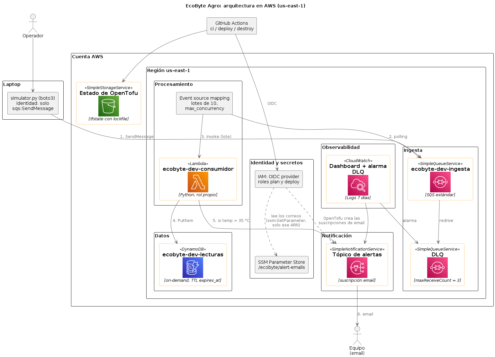

# Arquitectura

[← Volver al README](../README.md)

Cómo viaja una lectura desde el simulador hasta la tabla y el email, y qué recurso de AWS cumple cada función.



## Cómo funciona

```
simulador (laptop) -> SQS ingesta -> Lambda (lotes de 10) -> DynamoDB (TTL 30 días)
                          |                  |
                     (falla 3 veces)    temp > 35 °C -> SNS -> email
                          v
                         DLQ -> alarma de CloudWatch -> SNS -> email
```

1. El simulador envía lecturas `{"sensor_id", "timestamp", "temperature"}` a la cola de ingesta.
2. La cola desacopla a los sensores del procesamiento: si llegan más lecturas de las que se procesan, esperan en la cola sin perderse.
3. Lambda toma lotes de hasta 10 mensajes, con una concurrencia máxima configurable (5 en `dev`).
4. La función valida cada lectura y la guarda en DynamoDB con `expires_at` a 30 días, para que el TTL la borre sola.
5. Si alguna lectura del lote pasa de 35 °C, publica un solo email con todas ellas.
6. Los mensajes inválidos o que fallan vuelven a la cola (`batchItemFailures`). Después de 3 intentos pasan a la DLQ, y una alarma avisa por email.

## Componentes

| Componente | Servicio | Recurso |
|---|---|---|
| Cola de ingesta y DLQ | SQS | `ecobyte-dev-ingesta`, `ecobyte-dev-ingesta-dlq` |
| Función consumidora | Lambda (Python 3.13, 128 MB) | `ecobyte-dev-consumidor` |
| Base de lecturas | DynamoDB on-demand | `ecobyte-dev-lecturas` |
| Alertas | SNS (email) | `ecobyte-dev-alertas` |
| Observabilidad | CloudWatch | `ecobyte-dev-dashboard`, alarma de la DLQ, logs de 7 días |
| Secretos | SSM Parameter Store | `/ecobyte/alert-emails`, `/ecobyte/budget-emails` |
| Estado de OpenTofu | S3 con bloqueo | `ecobyte-agro-tfstate-<cuenta>` |

Por qué AWS y las equivalencias en otros proveedores: [Elección de provider](provider-aws.md).
