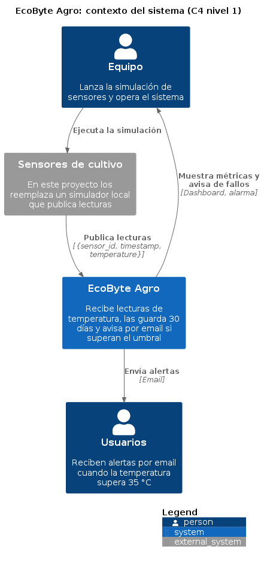
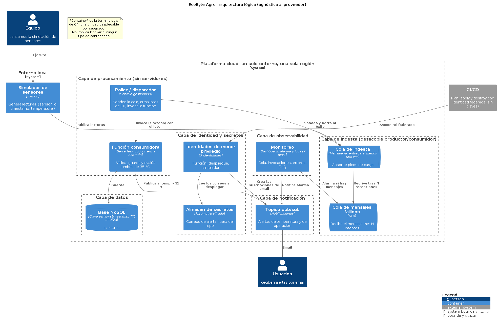
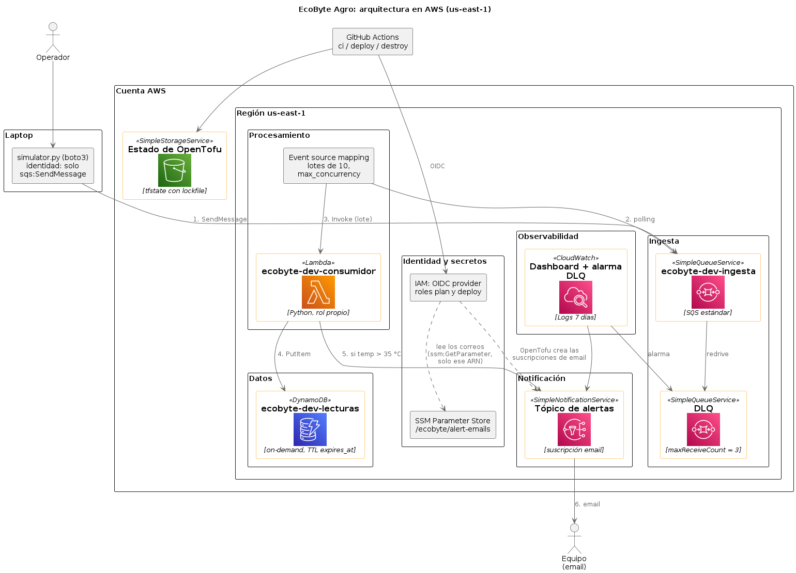
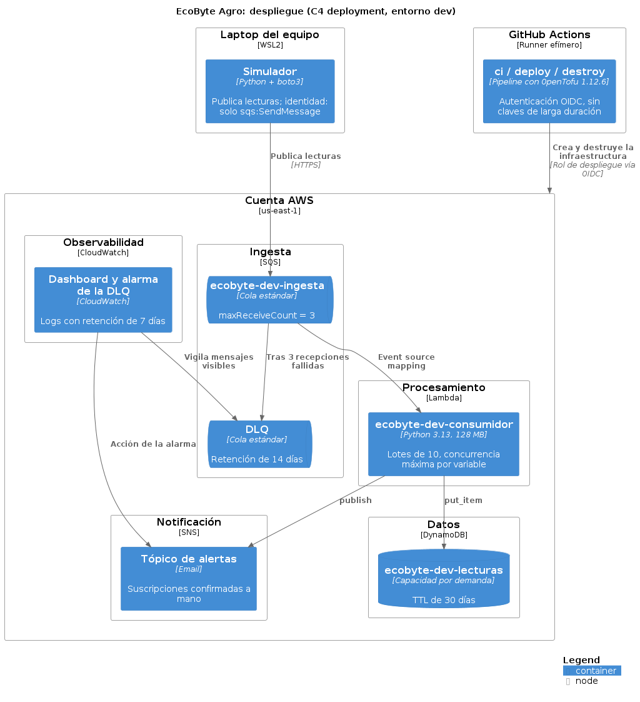
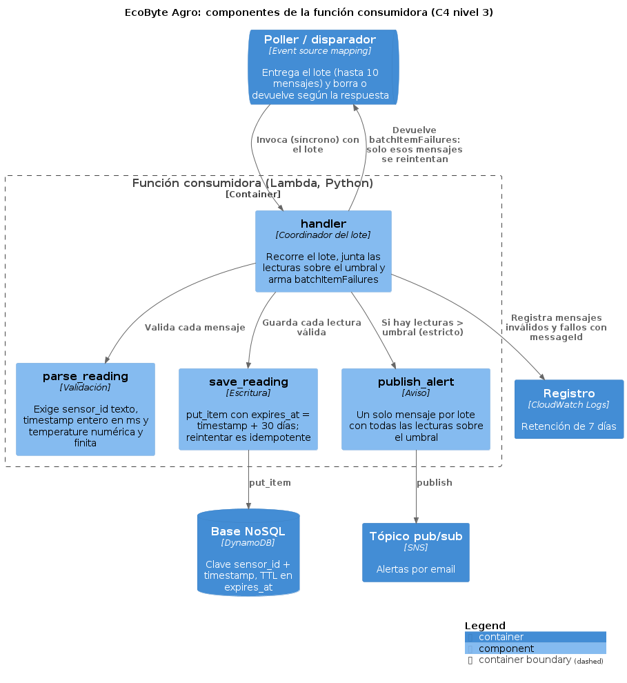
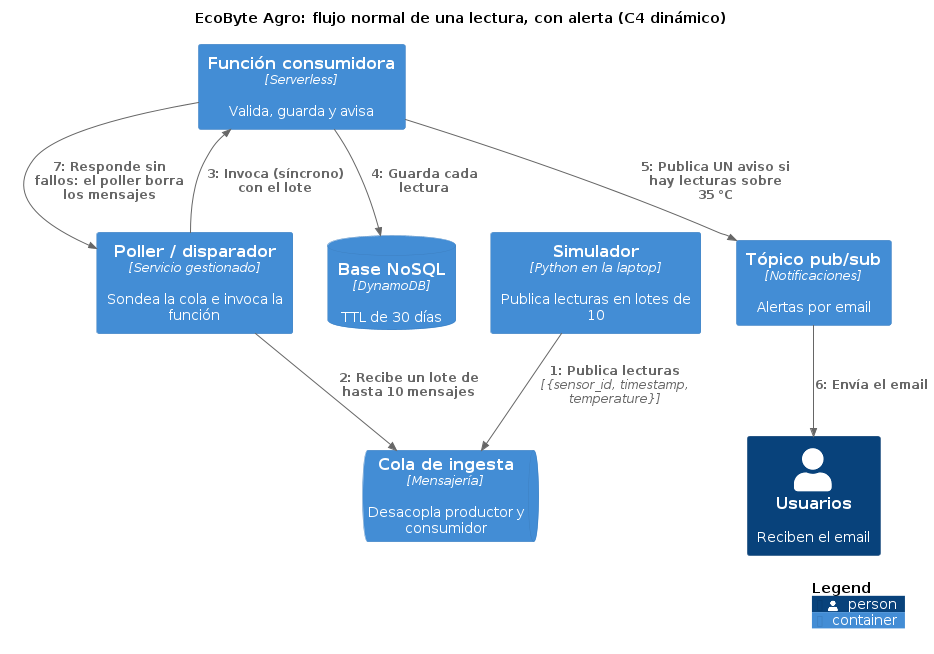
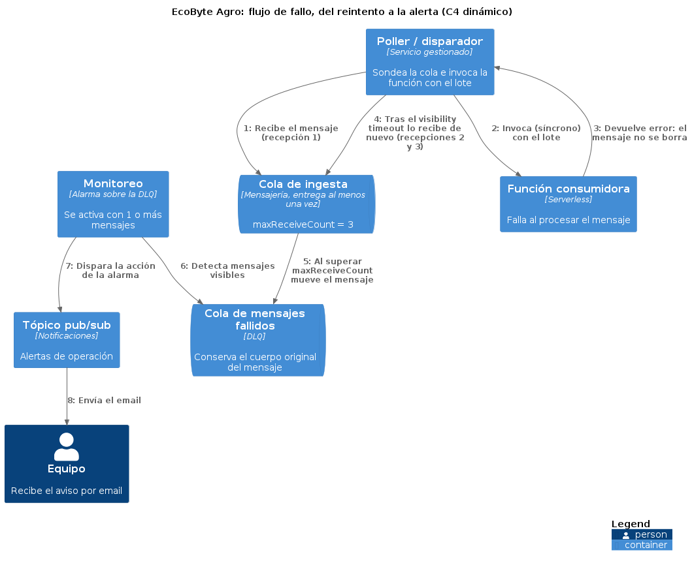
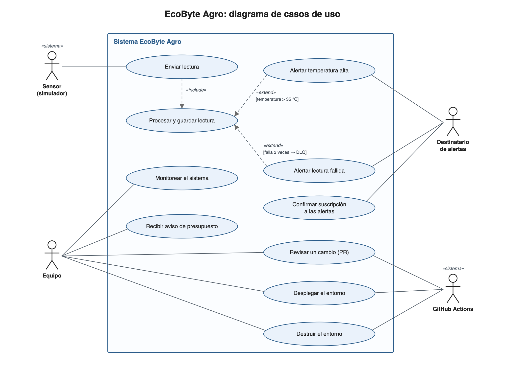
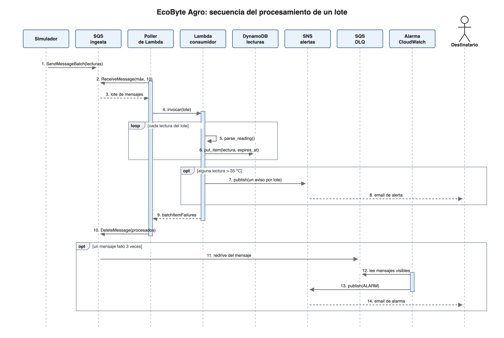
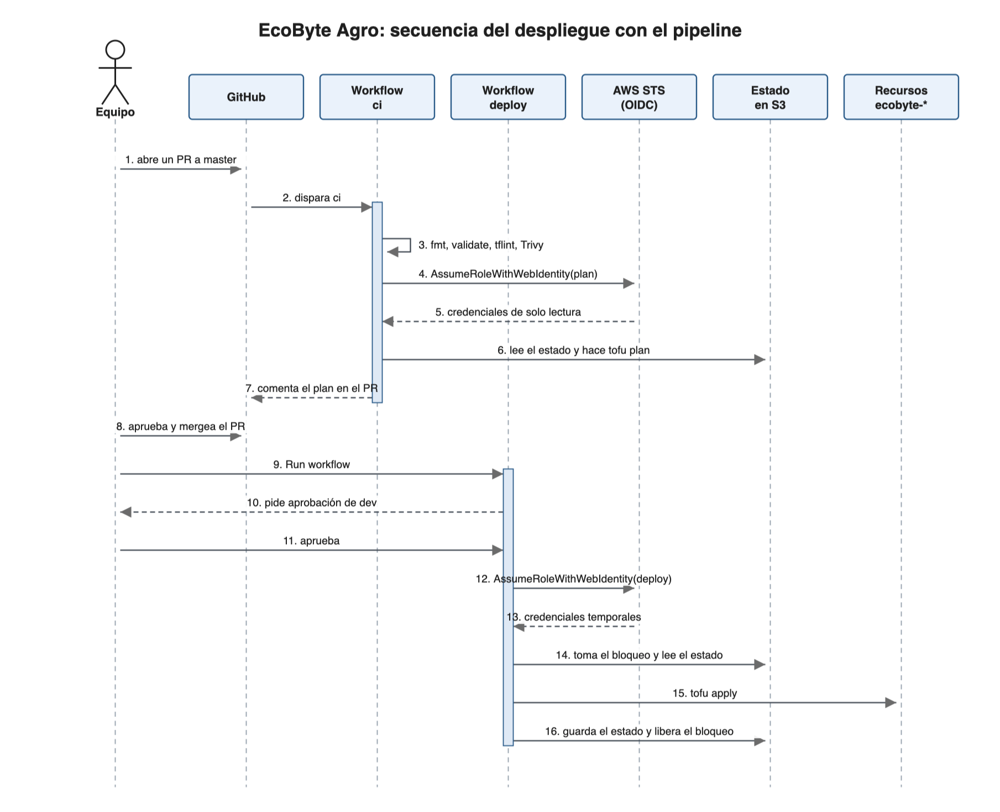

# Diagramas

[← Volver al README](../README.md)

Los diagramas C4 y de arquitectura están en [`diagramas/`](diagramas/), con su fuente en PlantUML (`.puml`) al lado de cada imagen. Los de casos de uso y de secuencia están en PNG y SVG.

- [Contexto (C4 nivel 1)](#contexto-c4-nivel-1)
- [Arquitectura lógica (independiente del proveedor)](#arquitectura-lógica-independiente-del-proveedor)
- [Arquitectura en AWS](#arquitectura-en-aws)
- [Despliegue (C4 deployment)](#despliegue-c4-deployment)
- [Componentes de la función (C4 nivel 3)](#componentes-de-la-función-c4-nivel-3)
- [Flujo normal de una lectura (C4 dinámico)](#flujo-normal-de-una-lectura-c4-dinámico)
- [Flujo de fallo (C4 dinámico)](#flujo-de-fallo-c4-dinámico)
- [Casos de uso](#casos-de-uso)
- [Secuencia: procesamiento de una lectura](#secuencia-procesamiento-de-una-lectura)
- [Secuencia: despliegue con el pipeline](#secuencia-despliegue-con-el-pipeline)

## Contexto (C4 nivel 1)

Quién usa el sistema y qué intercambia con él: el equipo lanza la simulación, los sensores publican lecturas, los usuarios reciben las alertas y el equipo ve métricas y avisos de fallos.

## Arquitectura lógica (independiente del proveedor)

El mismo diseño con componentes genéricos: cola, función, base NoSQL, tópico, monitoreo, secretos e identidades. Se puede implementar en AWS, Google Cloud o Azure; ver las equivalencias en [Elección de provider](provider-aws.md).

## Arquitectura en AWS

Los mismos componentes con los servicios de AWS. El recorrido paso a paso está en [Arquitectura](arquitectura.md).

## Despliegue (C4 deployment)

Dónde corre cada parte: el simulador en la laptop, el pipeline en GitHub Actions y el resto en la cuenta de AWS (`us-east-1`), con los nombres reales de los recursos.

## Componentes de la función (C4 nivel 3)

Cómo está armado `handler.py`: `parse_reading` valida, `save_reading` guarda con TTL, `publish_alert` manda un aviso por lote y `handler` coordina y arma la lista de fallidos.

## Flujo normal de una lectura (C4 dinámico)

Del simulador a la cola, de la cola a la función, y de ahí a la tabla y, si pasa de 35 °C, al email.

## Flujo de fallo (C4 dinámico)

Un mensaje que falla se reintenta. A la tercera recepción pasa a la DLQ, la alarma lo detecta y avisa por email.

## Casos de uso

Qué hace cada actor con el sistema, en notación UML. Los actores están fuera del límite del sistema: dos personas (el equipo y quien recibe las alertas) y dos sistemas externos (los sensores, que hoy son el simulador, y GitHub Actions). Las líneas sólidas unen a cada actor con lo que hace; las flechas punteadas son relaciones entre casos de uso.

- **«include»:** enviar una lectura siempre incluye procesarla y guardarla con TTL de 30 días.
- **«extend»:** las dos alertas amplían el procesamiento solo si se cumple su condición: una lectura sobre 35 °C, o un mensaje que falla 3 veces y pasa a la DLQ.
- **Desplegar, destruir y revisar un PR** los pide el equipo y los ejecuta GitHub Actions; deploy y destroy esperan la aprobación manual.
- **Confirmar la suscripción** se repite cada vez que se recrea el entorno; sin eso no llegan los emails.

La versión vectorial está en [`casos-de-uso.svg`](diagramas/casos-de-uso.svg).

## Secuencia: procesamiento de una lectura

El recorrido de un lote en notación UML: cada participante tiene su línea de vida, las barras muestran cuándo está activo, las flechas sólidas son llamadas y las punteadas, respuestas o avisos. Los recuadros marcan lo que se repite o es opcional:

- **loop:** la Lambda valida y guarda cada lectura del lote.
- **opt [alguna lectura > 35 °C]:** publica un solo aviso para todo el lote y SNS manda el email.
- **opt [un mensaje falló 3 veces]:** SQS lo pasa a la DLQ, la alarma lo detecta y avisa por email.

## Secuencia: despliegue con el pipeline

Cómo un cambio llega a AWS sin claves guardadas. El workflow `ci` revisa el PR y pide credenciales de solo lectura con OIDC para el `tofu plan`. Después del merge, `deploy` espera la aprobación del environment `dev`, pide credenciales temporales con el rol de despliegue y aplica con el estado bloqueado en S3.

El destroy sigue el mismo camino con el workflow `destroy` y `tofu plan -destroy`. Las versiones vectoriales están en [`secuencia-procesamiento.svg`](diagramas/secuencia-procesamiento.svg) y [`secuencia-despliegue.svg`](diagramas/secuencia-despliegue.svg).
