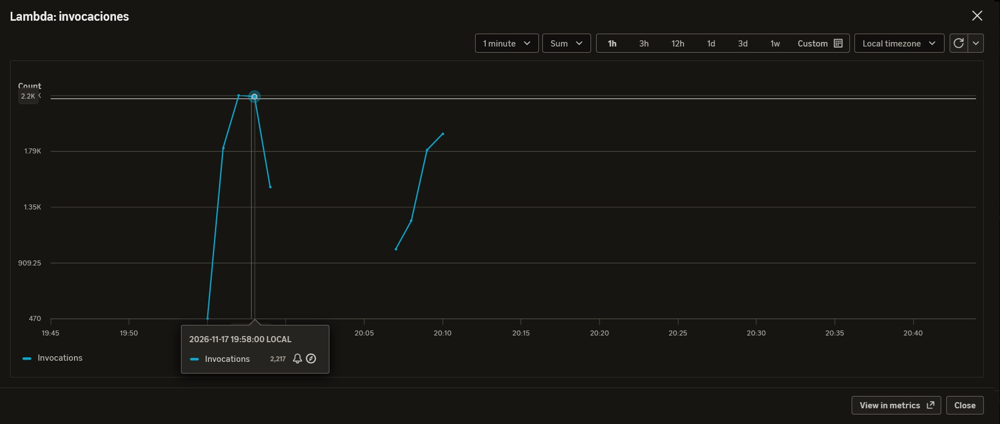
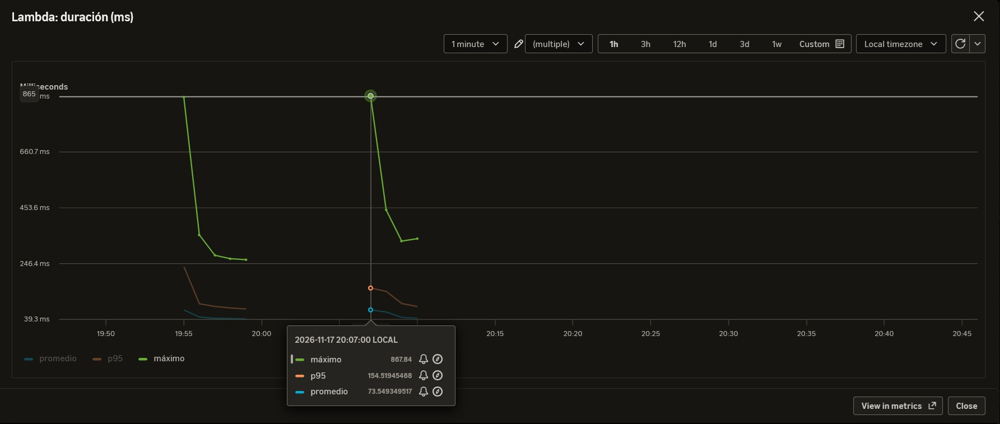
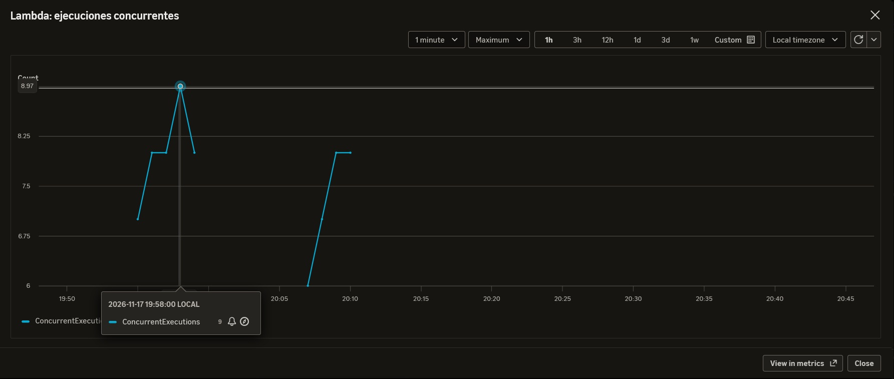
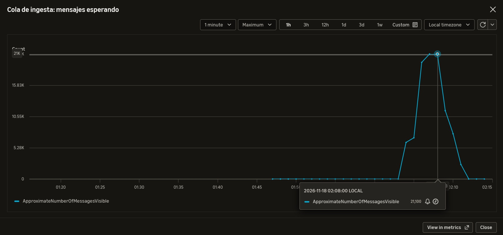
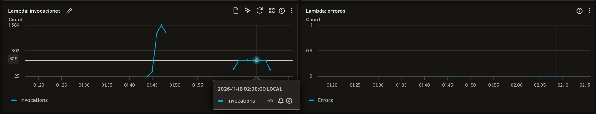
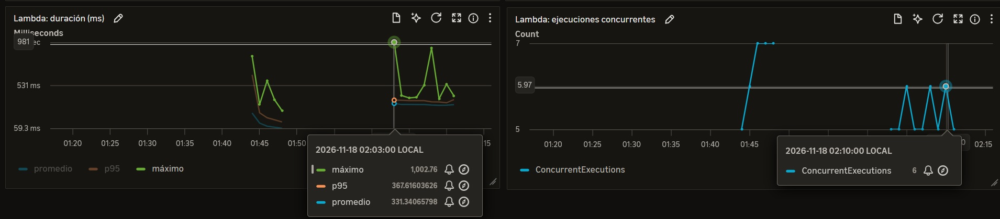
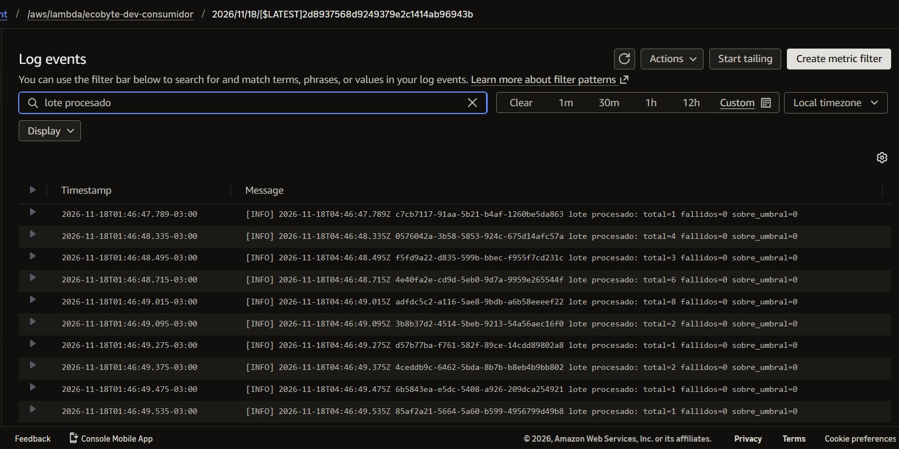
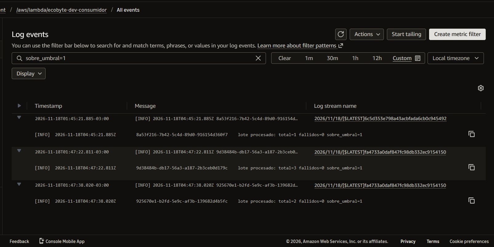
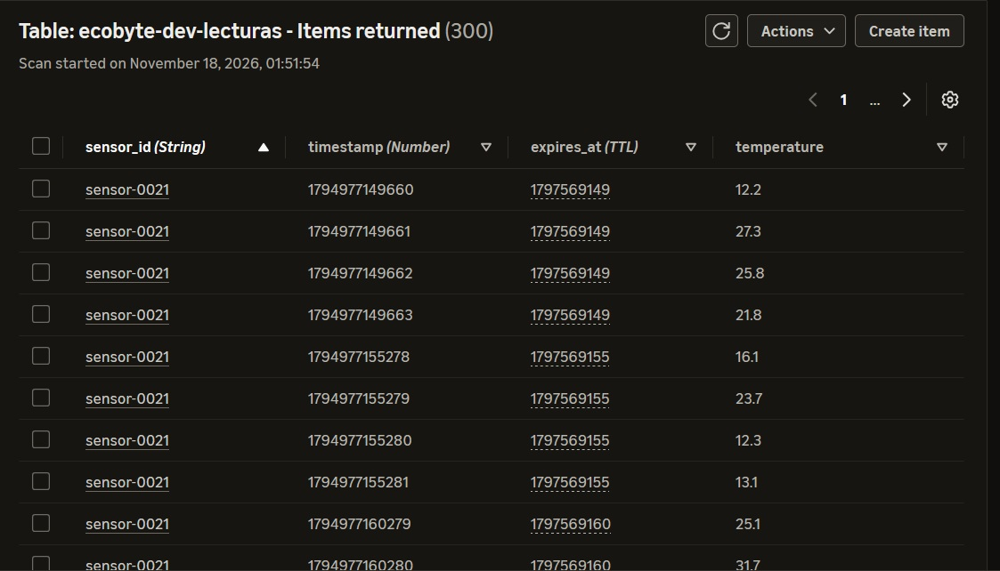

# Escalabilidad

Qué pasa con el sistema si la cantidad de sensores crece 10 y 100 veces, dónde se traba primero y qué servicio crece más rápido en costo.

> Datos de la documentación oficial de AWS (consultada el 3 de noviembre de 2026) y de las pruebas de carga del 17 y 18 de noviembre de 2026 (ver [Prueba de carga](#prueba-de-carga-17-de-noviembre-de-2026) y [Prueba con cuatro simuladores](#prueba-con-cuatro-simuladores-18-de-noviembre-de-2026)). Lo medido está marcado como tal; el resto son estimaciones. Los costos se confirman con la [calculadora de AWS](https://calculator.aws).

## Recorrido de un mensaje

```
simulador -> SQS ingesta -> Lambda (lotes de 10, concurrencia máxima 5) -> DynamoDB
                                     └─ temperatura > 35 °C -> SNS -> email
```

Cada servicio escala por su cuenta. La cola desacopla a quien produce (los sensores) de quien consume (la Lambda): si llegan más mensajes de los que la Lambda puede procesar, se acumulan en la cola y se procesan después, sin perderse.

## Supuestos

| Supuesto | Valor | De dónde sale |
|---|---|---|
| Frecuencia de cada sensor | 1 lectura por minuto | Supuesto del equipo |
| Lecturas sobre 35 °C | 1 % | Valor por defecto del simulador (`--hot-ratio 0.01`) |
| Suscriptores del tópico de alertas | 2 | Los dos integrantes |
| Tiempo por lote de 10 mensajes | 318 ms | Medido el 18 de noviembre con lotes llenos (promedio de 4.005 invocaciones). La estimación inicial era 100 ms |
| Memoria de la Lambda | 128 MB | `memory_mb` del módulo `consumer` |
| Tamaño de cada ítem en DynamoDB | ~200 bytes | Cuatro atributos chicos más la sobrecarga del ítem |
| Retención de lecturas | 30 días | TTL de la tabla |
| Pedidos a SQS por mensaje | 0,3 | Envío, recepción y borrado en lotes de 10 |
| Logs por invocación | ~500 bytes | Líneas `START`, `END` y `REPORT` |
| Región | `us-east-1` | Región del proyecto |

Los costos están **sin capa gratuita**, para que se pueda comparar entre escenarios.

## Escenarios

| | Base | 10x | 100x |
|---|---|---|---|
| Sensores | 1.000 | 10.000 | 100.000 |
| Mensajes por segundo (promedio) | 17 | 167 | 1.667 |
| Mensajes por mes | 43 M | 432 M | 4.320 M |
| Lambdas en paralelo necesarias (a partir de lo medido) | 1,0 | 9,9 | 99 |
| Emails de alerta por segundo (por suscripción) | 0,2 | 1,7 | 16,7 |
| Datos guardados en DynamoDB | 9 GB | 86 GB | 864 GB |

Las Lambdas en paralelo salen de: mensajes por segundo ÷ 16,8, que es lo que procesó cada ejecución concurrente en la prueba con cuatro simuladores del 18 de noviembre (84 mensajes por segundo con `max_concurrency = 5`). Es un valor medido, pero solo se probó con concurrencia 5: con más concurrencia el rendimiento por ejecución podría cambiar, así que la fila es una proyección lineal. Las estimaciones anteriores (0,5, 4,8 y 48, con 29 ms por mensaje) daban cerca de la mitad: subestimaban la concurrencia necesaria.

## Costo mensual estimado (USD)

| Servicio | Base | 10x | 100x |
|---|---|---|---|
| SQS | 5 | 52 | 518 |
| Lambda | 4 | 37 | 370 |
| DynamoDB, escrituras | 27 | 270 | 2.700 |
| DynamoDB, almacenamiento | 2 | 22 | 216 |
| SNS, emails | 17 | 173 | 1.728 |
| CloudWatch Logs | 1 | 11 | 108 |
| **Total** | **~56** | **~565** | **~5.640** |

El costo crece lineal con los sensores: 10 veces más sensores, 10 veces más costo. Es lo esperable en serverless, donde se paga por uso y no por capacidad reservada.

La tabla es una estimación con precios de lista, no sale de la facturación. La fila de Lambda usa el tiempo medido por lote lleno (318 ms, 128 MB); antes se había calculado con 100 ms supuestos (USD 2, 18 y 176). Se calculó con lotes de 10 mensajes, pero a volúmenes bajos, donde los lotes no se llenan (en la prueba del 17 de noviembre, 1,6 mensajes por invocación), Lambda y SQS cuestan más: con ese promedio, la Lambda del escenario base costaría unos USD 8 en vez de 4. DynamoDB sigue siendo el servicio más caro.

Precios usados (`us-east-1`, lista de precios pública de AWS):

| Servicio | Precio |
|---|---|
| SQS estándar | USD 0,40 por millón de pedidos |
| Lambda | USD 0,20 por millón de invocaciones y USD 0,0000166667 por GB-segundo |
| DynamoDB on-demand | USD 0,625 por millón de escrituras y USD 0,25 por GB al mes |
| SNS email | USD 2 cada 100.000 notificaciones |
| CloudWatch Logs | USD 0,50 por GB ingerido |

## Cuello de botella de rendimiento: la concurrencia de la Lambda

La capacidad con `max_concurrency = 5` depende del tiempo que tarda un lote. El handler guarda cada lectura con un `put_item` por separado, así que el tiempo crece con el tamaño del lote. La prueba del 18 de noviembre lo midió con lotes llenos: **318 ms por invocación de 10 mensajes** (p95 361 ms). En teoría el consumidor procesaría como máximo:

```
5 Lambdas × 10 mensajes por lote ÷ 0,318 s = unos 157 mensajes por segundo
```

**Lo medido fue la mitad: unos 84 mensajes por segundo** (unas 505 invocaciones por minuto de 10 mensajes). La causa no se investigó (la métrica de concurrencia sí marcó 5 o 6 ejecuciones, así que el tope se usó). Para dimensionar se usa el valor medido.

| Escenario | Llegan | Se procesan (medido con `max_concurrency = 5`) | Resultado |
|---|---|---|---|
| Base | 17/s | ~84/s | Sobra capacidad (unas 5 veces) |
| 10x | 167/s | ~84/s | La cola crece unos 83 mensajes por segundo: 10x ya satura |
| 100x | 1.667/s | ~84/s | La cola crece sin parar (20 veces más de lo que se procesa) |

Con cuatro simuladores a 222 mensajes por segundo, un ritmo parecido al de 10x, la cola llegó a 21.100 mensajes y se vació unos 5 minutos después de terminar el envío (ver [la prueba](#prueba-con-cuatro-simuladores-18-de-noviembre-de-2026)). El límite aparece antes de lo previsto en la estimación inicial: 10x ya no se sostiene con la configuración actual. Las opciones:

1. **Subir `max_concurrency`.** Es una variable del módulo `consumer` y acepta de 2 a 1.000. Con el rendimiento medido (~17 mensajes por segundo por ejecución), para 10x hacen falta unas 10 y para 100x unas 100 (proyección lineal, no probada).
2. **Pedir más concurrencia para la cuenta.** El límite de esta cuenta es **10** ejecuciones simultáneas (medido con `aws lambda get-account-settings --query AccountLimit` el 17 de noviembre de 2026), muy por debajo de los 1.000 por defecto de AWS. Con 10 se llega justo a 10x y no a 100x: hay que pedir el aumento en Service Quotas antes de subir `max_concurrency`.
3. **Escribir en lotes.** Cambiar los `put_item` por `batch_write_item` (hasta 25 ítems por llamada) baja el tiempo por lote y sube la capacidad con la misma concurrencia. Es un cambio de código y no se hizo.
4. **Techo del vínculo con SQS.** Lambda empieza con 5 invocaciones en paralelo y suma hasta 300 por minuto, con un máximo de 1.250 para colas estándar. Más allá hay que activar el modo aprovisionado (hasta 100.000).

## El límite también protege a la base de datos

Los sensores pueden mandar todos a la vez (por ejemplo, en el segundo :00 de cada minuto). En 100x serían 100.000 mensajes de golpe.

- SQS los absorbe: las colas estándar aceptan llamadas "casi ilimitadas" por segundo y no tienen tope de mensajes en espera.
- Una tabla on-demand nueva aguanta 4.000 escrituras por segundo de entrada y puede duplicar su pico anterior. Si se pasa del doble en menos de 30 minutos, puede rechazar escrituras (throttling).
- Con `max_concurrency` acotado, la Lambda saca mensajes de la cola a un ritmo que DynamoDB puede aguantar. Sin ese límite, la Lambda podría escalar más rápido que la tabla.

Este es el desacople que buscamos con la cola: el pico se transforma en una cola que se vacía a ritmo constante.

## Lo que más crece en costo: escrituras en DynamoDB

DynamoDB es cerca del 50 % del costo en todos los escenarios. Lambda y SQS trabajan en lotes de 10, pero DynamoDB cobra cada escritura por separado: una lectura de sensor es una escritura.

Formas de bajarlo:

- **Agregar antes de guardar.** Guardar un promedio por sensor por minuto o por hora en vez de cada lectura. Es el extra opcional de "agregación por hora".
- **Bajar la frecuencia de los sensores.** Una lectura cada 5 minutos en vez de cada minuto divide el costo por 5.
- **Capacidad aprovisionada.** Con carga estable y predecible puede salir más barata que on-demand. Habría que compararlo en la calculadora.

## Problema de diseño: una alerta por lectura no escala

Hoy el handler manda un email por lote, con todas las lecturas sobre 35 °C de ese lote. Con 1 % de lecturas calientes, casi todos los lotes con alerta tienen una sola lectura, así que en la práctica es un email por lectura caliente.

- En 100x serían unos 86 millones de emails por mes (USD 1.728) y 16,7 por segundo por suscripción.
- SNS tiene un límite fijo de 10 emails por segundo por suscripción, que no se puede aumentar. Los emails se atrasarían.
- Además, nadie puede leer esa cantidad de alertas.

La solución es deduplicar: por ejemplo, una alerta por sensor cada 15 minutos, o un resumen periódico con los sensores que pasaron el umbral. Para el alcance del proyecto (demo con pocos sensores) no hace falta, pero es el primer cambio si el sistema creciera.

## Prueba de carga (17 de noviembre de 2026)

Se desplegó el entorno `dev` y se corrieron dos pruebas de 10.000 mensajes con el simulador (50 sensores, lotes de 10 hacia la cola) contra la Lambda real, con `max_concurrency = 5`, 128 MB y la cuota de la cuenta en 10.

| | Corrida 1 | Corrida 2 |
|---|---|---|
| Mensajes enviados / fallidos | 10.000 / 0 | 10.000 / 0 |
| Lecturas sobre 35 °C | 493 (`--hot-ratio 0.05`) | 5 (`--hot-ratio 0.0005`) |
| Duración del envío | 242 s | 232 s |
| Tasa medida | 41 mensajes/s | 43 mensajes/s |
| Invocaciones de la Lambda | 6.720 | 5.525 |
| Errores y throttles | 0 | 0 |
| Mensajes en la DLQ | 0 | 0 |
| Alarma de la DLQ | `OK` | `OK` |

- **Resultado:** las 20.000 lecturas quedaron en la tabla `ecobyte-dev-lecturas` (conteo con `scan`) y la cola de ingesta terminó vacía.
- **Duración por invocación** (ambas corridas): promedio 48 ms, p50 39 ms, p99 201 ms. El primer minuto de cada corrida es el más lento (promedio de 73 ms y máximo de 868 ms, por el arranque de los entornos de ejecución) y después baja a unos 40 ms.
- **Mensajes por invocación:** unos 1,6 en promedio (12.245 invocaciones para 20.000 mensajes). El consumidor absorbe la carga más rápido de lo que llega, y SQS entrega lo que hay sin esperar a llenar el lote de 10.
- **Concurrencia máxima observada:** 9 ejecuciones (`ConcurrentExecutions`, pico de 8,97 a las 19:58), con una meseta de 8 durante las dos corridas. La configuración es `max_concurrency = 5` y la cuota de la cuenta es 10.
- **Pico de invocaciones:** unas 2.200 por minuto (corrida 1).
- **Escala a cero:** entre las dos corridas la función no tuvo invocaciones, y por lo tanto no generó costo.

Capturas del dashboard `ecobyte-dev-dashboard` (CloudWatch, resolución de 1 minuto, rango de 1 hora, hora local UTC-3). La corrida 1 va de 19:55 a 19:59 y la corrida 2, de 20:07 a 20:11. El hueco entre las dos son minutos sin invocaciones.

**Invocaciones por minuto (`Sum`).** La función pasa de cero a más de 2.000 invocaciones por minuto sin ninguna configuración y vuelve a cero al terminar el envío.



**Duración por invocación (promedio, p95 y máximo).** El máximo y el p95 se disparan en el primer minuto de cada corrida (868 ms y 154 ms) y se estabilizan después, mientras el promedio se mantiene bajo.



**Ejecuciones concurrentes (`Maximum`).** Con `max_concurrency = 5` se esperaban 5 ejecuciones en paralelo, y se observaron 8 de forma sostenida y 9 en el pico. Queda pendiente entender la diferencia (ver Pendiente).



Límites de la prueba:

- El simulador desde la laptop fue el cuello de botella: se pidieron 100 mensajes por segundo y se midieron 41 a 43. La prueba confirma el escenario base con margen (17/s) y no llegó a cargar el sistema como en 10x (167/s) ni en 100x.
- La cola no se acumuló, así que no se vio el efecto del tope de concurrencia ni la protección de DynamoDB.
- No se midió un lote lleno de 10 mensajes. Ambos puntos se cubrieron el 18 de noviembre con cuatro simuladores en paralelo (sección siguiente).

## Prueba con cuatro simuladores (18 de noviembre de 2026)

Para cargar el consumidor más que con un solo simulador (que desde la laptop no pasa de unos 58 mensajes por segundo), se lanzaron **cuatro simuladores en paralelo**, cada uno con 10.000 mensajes, `--hot-ratio 0` (sin alertas, para no generar correos) y `max_concurrency = 5`. Antes se corrió una prueba de 10.000 mensajes con un solo simulador.

| | Un simulador | Cuatro simuladores |
|---|---|---|
| Mensajes enviados / fallidos | 10.000 / 0 | 40.000 / 0 |
| Duración del envío | 173 s | ~180 s |
| Tasa de envío | 58 mensajes/s | ~222 mensajes/s (55 a 57 por simulador) |
| Cola de ingesta | siempre en 0 | pico de **21.100** mensajes (02:07 y 02:08, hora local) |
| Cola vacía | al terminar el envío | unos 8 min después de empezar (5 min después de terminar el envío) |
| Mensajes por invocación | de 1 a 10 | 10 (3.995 líneas `total=10` en los logs) |
| Invocaciones | — | 4.005, unas 505 por minuto en la meseta |
| Duración por invocación | — | promedio 318 ms, p50 317 ms, p95 361 ms, máximo 1.003 ms |
| Concurrencia máxima | — | 5 a 6 por minuto |
| Lotes con fallos / errores | 0 | 0 |
| Ítems en `ecobyte-dev-lecturas` | 10.101 acumulados, sin pérdidas | 47.351 acumulados (esperados 50.101) |

- **Capacidad medida:** el consumidor procesó 40.000 mensajes en unos 500 s: **unos 80 a 84 mensajes por segundo** con `max_concurrency = 5`. Mientras entraban 222 por segundo, la cola creció a ese ritmo menos lo que se consumía, y al terminar el envío drenó.
- **La cola amortigua el pico:** con la cola en 21.100 no hubo errores ni mensajes fallidos en los logs, y el mensaje más viejo esperó hasta 291 s (unos 5 minutos). Es el desacople buscado: el pico se convierte en espera, no en pérdida.
- **El cuello de botella es la concurrencia del consumidor**, no SQS ni DynamoDB: no hubo errores de escritura ni throttling.
- **Diferencia de ítems en la tabla (2.750):** es consistente con lecturas de simuladores distintos que coinciden en el mismo `sensor_id` y el mismo milisegundo. La clave `sensor_id` + `timestamp` es idempotente, así que se pisan en lugar de duplicarse. No se verificó directamente: con un solo simulador no ocurrió (10.101 ítems exactos).
- **Límite de la prueba:** los cuatro procesos comparten la laptop y su conexión, así que el ritmo real quedó en 222 mensajes por segundo y no en los 300 pedidos.
- **Rendimiento por debajo de lo teórico:** el cálculo da 157 mensajes por segundo (5 × 10 ÷ 0,318 s) y se midieron unos 84. No se investigó la causa.
- **Concurrencia en las dos pruebas:** el 17 de noviembre la métrica marcó 8 y 9 ejecuciones; el 18, de 5 a 6. Ambas con `max_concurrency = 5`; la diferencia no está explicada.

**Cola de ingesta: mensajes esperando (`Maximum`, 1 minuto).** Sube a 21.100 mensajes y baja a cero a las 02:12.



**Invocaciones y errores de la Lambda.** Unas 500 invocaciones por minuto de forma sostenida y 0 errores. El primer grupo de puntos (01:44 a 01:48) es la prueba de un solo simulador.



**Duración y ejecuciones concurrentes.** Promedio de 331 ms y máximo de 1.003 ms en el primer minuto (02:03) y concurrencia de 5 a 6.



**Logs de la Lambda (un simulador, 10.000 mensajes).** Cada línea `lote procesado` indica `fallidos=0`; el tamaño del lote es de 1 a 8 mensajes porque el consumidor va más rápido que el envío.



**Logs de la Lambda (lecturas sobre el umbral).** Tres lotes con `sobre_umbral=1` en tres log streams: la lectura caliente enviada a propósito y dos de la prueba grande.



**Tabla `ecobyte-dev-lecturas`.** Cada ítem lleva `sensor_id`, `timestamp` (milisegundos), `temperature` y `expires_at`, el atributo de TTL a 30 días (los segundos en epoch, en la columna marcada TTL).



## SQS no es el límite

- Las colas estándar no tienen un tope fijo de mensajes por segundo.
- No hay límite de mensajes esperando en la cola.
- Solo hay un tope de ~120.000 mensajes "en proceso" (recibidos y no borrados) al mismo tiempo, muy por encima de lo que usa el consumidor (5 Lambdas × 10 mensajes = 50).
- Si los mensajes se acumulan, la retención es de 4 días, ampliable a 14.

## Resumen

| Pregunta | Respuesta |
|---|---|
| ¿Qué se traba primero? | La concurrencia de la Lambda (medido: unos 84 msg/s con `max_concurrency = 5`; la cuota de la cuenta es 10). 10x (167/s) ya la supera y 100x la supera 20 veces. |
| ¿Cómo se arregla? | Subir `max_concurrency` (unas 10 para 10x y unas 100 para 100x, proyección lineal), pedir antes más concurrencia para la cuenta y escribir en lotes con `batch_write_item`. |
| ¿Qué crece más en costo? | Las escrituras en DynamoDB (~50 % del total). |
| ¿Qué no escala por diseño? | Una alerta por email por lectura. |
| ¿Qué escala sin cambios? | SQS y el almacenamiento de DynamoDB (el TTL limita lo guardado a 30 días). |

## Pendiente

- [x] Medir el tiempo por invocación en la prueba de 10.000 mensajes (48 ms con ~1,6 mensajes) y recalcular la capacidad.
- [x] Consultar el límite de concurrencia de Lambda de la cuenta (10).
- [x] Medir el tiempo de un lote lleno de 10 mensajes (318 ms en la prueba con cuatro simuladores del 18 de noviembre).
- [ ] Explicar por qué la concurrencia llegó a 9 con `max_concurrency = 5` el 17 de noviembre y por qué el rendimiento medido (84 msg/s) es la mitad del teórico (157 msg/s).
- [ ] Verificar que la diferencia de ítems en la tabla (2.750) sea por coincidencia de `sensor_id` y milisegundo entre simuladores.
- [ ] Pedir el aumento de la cuota de concurrencia en Service Quotas (necesario para 10x y 100x).
- [ ] Cargar los tres escenarios en la calculadora de AWS y adjuntar el link.
- [x] Agregar las capturas de invocaciones, duración y concurrencia de la prueba de carga.
- [x] Agregar las capturas de errores, de los logs y de la tabla de DynamoDB (ítems con `expires_at`).
- [ ] Agregar la captura de la DLQ (`DLQLecturasFallaron.jpg` está en `docs/assets/` pero no se usa en el documento).

## Fuentes

- [Escalado de Lambda con SQS](https://docs.aws.amazon.com/lambda/latest/dg/services-sqs-scaling.html)
- [Límites de Lambda](https://docs.aws.amazon.com/lambda/latest/dg/gettingstarted-limits.html)
- [Límites de mensajes de SQS](https://docs.aws.amazon.com/AWSSimpleQueueService/latest/SQSDeveloperGuide/quotas-messages.html)
- [Límites de colas de SQS](https://docs.aws.amazon.com/AWSSimpleQueueService/latest/SQSDeveloperGuide/quotas-queues.html)
- [DynamoDB on-demand](https://docs.aws.amazon.com/amazondynamodb/latest/developerguide/on-demand-capacity-mode.html)
- [Límites de SNS](https://docs.aws.amazon.com/general/latest/gr/sns.html)
- Precios: [SQS](https://aws.amazon.com/sqs/pricing/), [Lambda](https://aws.amazon.com/lambda/pricing/), [DynamoDB](https://aws.amazon.com/dynamodb/pricing/on-demand/), [SNS](https://aws.amazon.com/sns/pricing/), [CloudWatch](https://aws.amazon.com/cloudwatch/pricing/)
