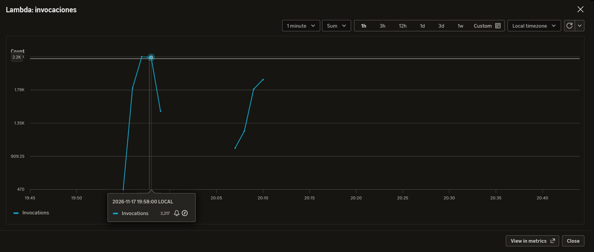
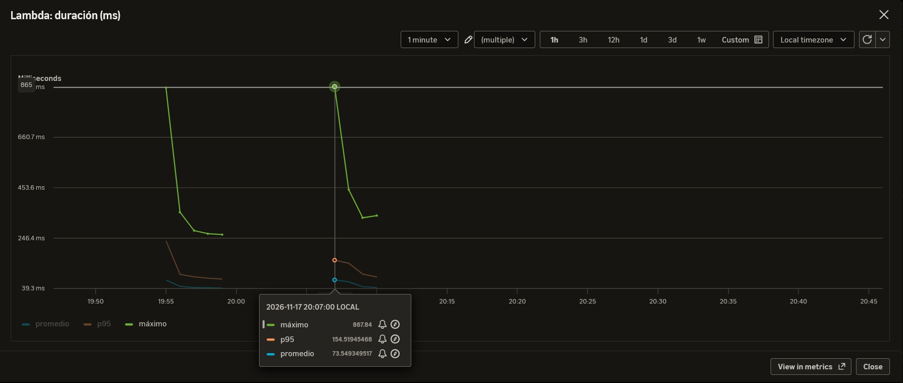
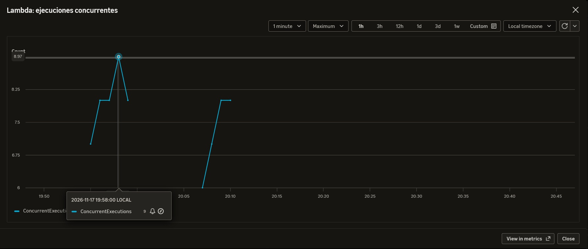
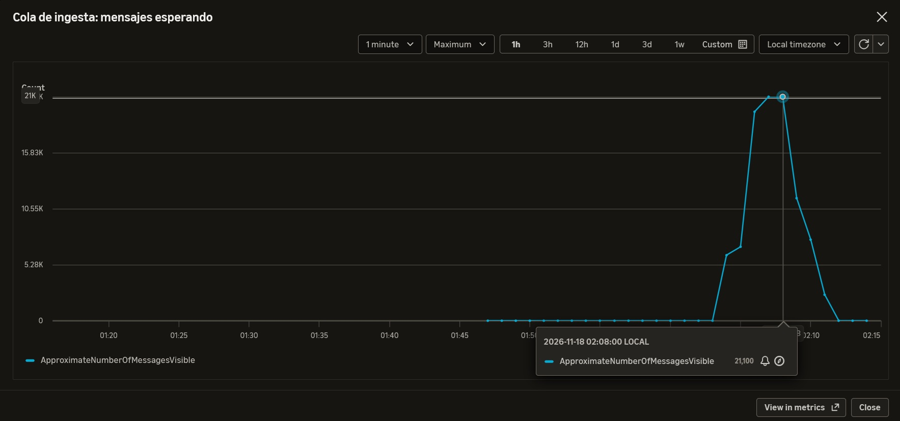
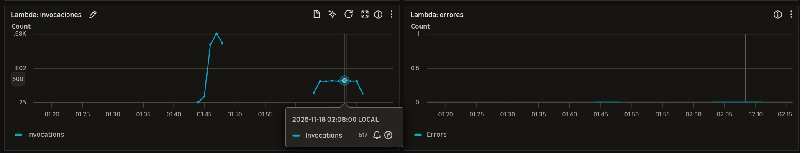
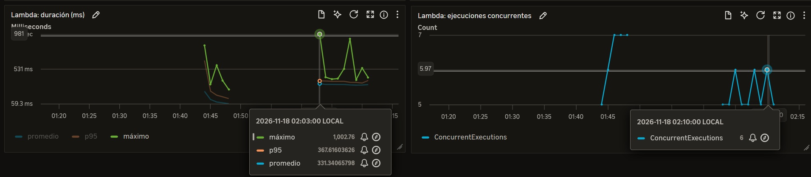
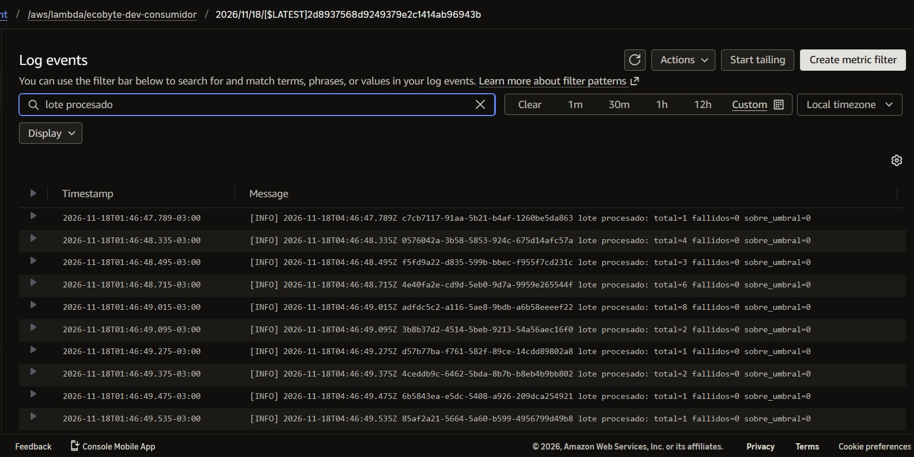
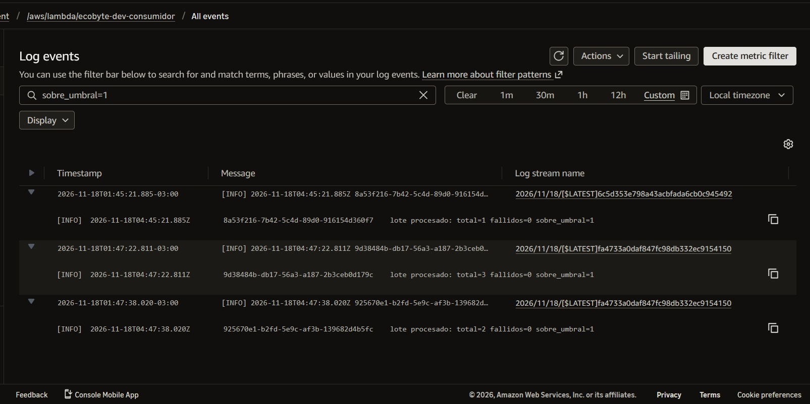
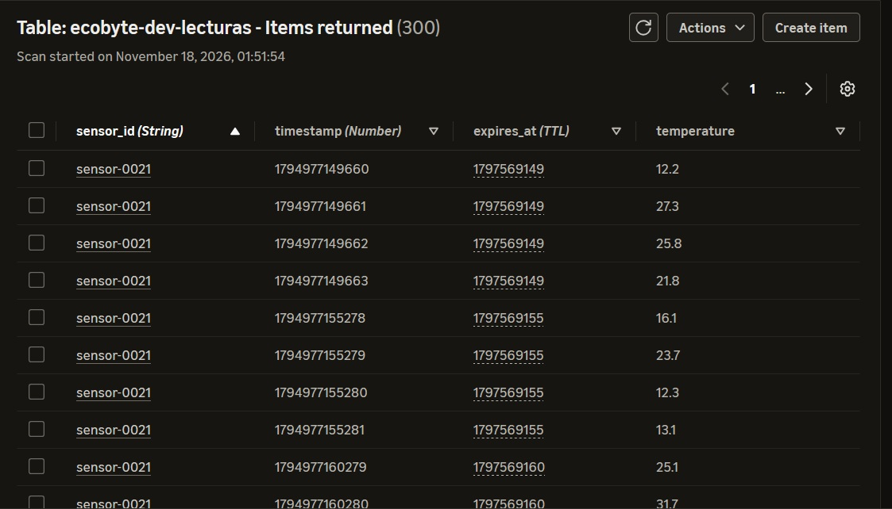

# Pruebas de carga

[← Volver al README](../README.md)

Tres pruebas contra el entorno `dev` real, con `max_concurrency = 5`, 128 MB y la cuota de la cuenta en 10. Lo que significan para 10x y 100x está en [Escalabilidad](escalabilidad.md).

- [Resultados](#resultados)
- [Qué mostraron](#qué-mostraron)
- [Capturas: 10.000 lecturas](#capturas-10000-lecturas-17-de-noviembre)
- [Capturas: cuatro simuladores](#capturas-cuatro-simuladores-18-de-noviembre)
- [Pendiente](#pendiente)

## Resultados

| | 10.000 lecturas (x2) | Un simulador | Cuatro simuladores |
|---|---|---|---|
| Fecha | 17 de noviembre | 18 de noviembre | 18 de noviembre |
| Mensajes enviados / fallidos | 20.000 / 0 | 10.000 / 0 | 40.000 / 0 |
| Ritmo de envío | 41 a 43 por segundo | 58 por segundo | ~222 por segundo |
| Mensajes en la cola (pico) | 0 | 0 | **21.100** |
| Mensajes por invocación | ~1,6 | 1 a 10 | 10 |
| Duración por invocación | 48 ms promedio | — | 318 ms promedio (p95 361 ms) |
| Concurrencia máxima | 9 | — | 5 a 6 |
| Errores, throttles y DLQ | 0 | 0 | 0 |

## Qué mostraron

- **Capacidad:** con lotes llenos, el consumidor procesa unos **84 mensajes por segundo**. La cuenta teórica da 157 (5 × 10 ÷ 0,318 s); la diferencia no se investigó y para dimensionar se usa lo medido.
- **La cola amortigua el pico:** con 21.100 mensajes esperando no hubo errores, y la cola se vació 5 minutos después de terminar el envío. El pico se convierte en espera, no en pérdida.
- **Escala sola y vuelve a cero:** pasó de 0 a unas 2.200 invocaciones por minuto sin configurar nada, y entre corridas no hubo invocaciones ni costo.
- **Arranque en frío:** el primer minuto de cada corrida es el más lento (hasta 868 ms) y después se estabiliza.
- **Escritura idempotente:** en la prueba de cuatro simuladores la tabla tiene 2.750 ítems menos de los esperados. Lo más probable es que lecturas del mismo sensor y el mismo milisegundo se pisaran, porque la clave es `sensor_id` + `timestamp`. No se verificó.
- **Límite de las pruebas:** el simulador corre en la laptop, que no pasa de unos 58 mensajes por segundo por proceso. Por eso se usaron cuatro en paralelo.

## Capturas: 10.000 lecturas (17 de noviembre)

Dashboard `ecobyte-dev-dashboard`, 1 minuto de resolución, hora local (UTC-3). Corrida 1 de 19:55 a 19:59 y corrida 2 de 20:07 a 20:11.

**Invocaciones por minuto.** De cero a unas 2.200 y de vuelta a cero.

**Duración.** Picos en el primer minuto de cada corrida (arranque en frío).

**Ejecuciones concurrentes.** Meseta de 8 y pico de 9, con `max_concurrency = 5`. La diferencia no está explicada.

## Capturas: cuatro simuladores (18 de noviembre)

**Cola de ingesta.** Sube a 21.100 mensajes y baja a cero a las 02:12.

**Invocaciones y errores.** Unas 500 invocaciones por minuto y 0 errores. Los primeros puntos (01:44 a 01:48) son la prueba de un solo simulador.

**Duración y concurrencia.** Promedio de 331 ms y concurrencia de 5 a 6.

**Logs.** Cada lote procesado con `fallidos=0`.

**Logs de lecturas sobre el umbral.** Tres lotes con `sobre_umbral=1`.

**Tabla `ecobyte-dev-lecturas`.** Cada ítem con `sensor_id`, `timestamp`, `temperature` y `expires_at` (el TTL a 30 días).

## Pendiente

- Explicar por qué la concurrencia llegó a 9 con `max_concurrency = 5` y por qué se procesan 84 mensajes por segundo y no 157.
- Verificar que la diferencia de ítems (2.750) sea por lecturas que coinciden en sensor y milisegundo.
- Agregar la captura de la DLQ (`DLQLecturasFallaron.jpg` está en `docs/assets/` pero no se usa).
